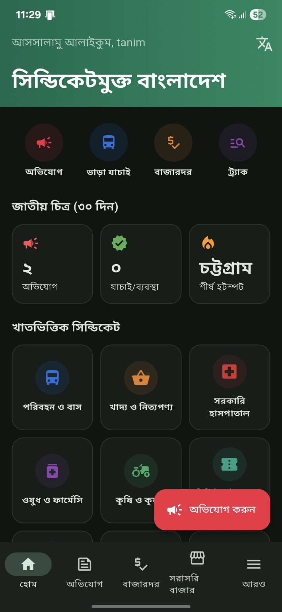
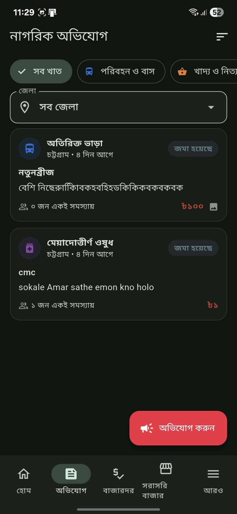
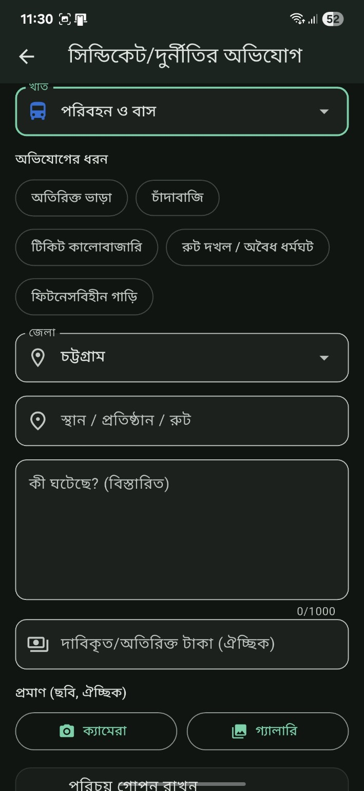
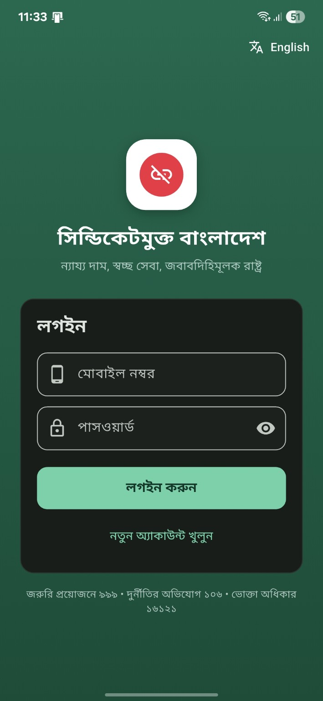
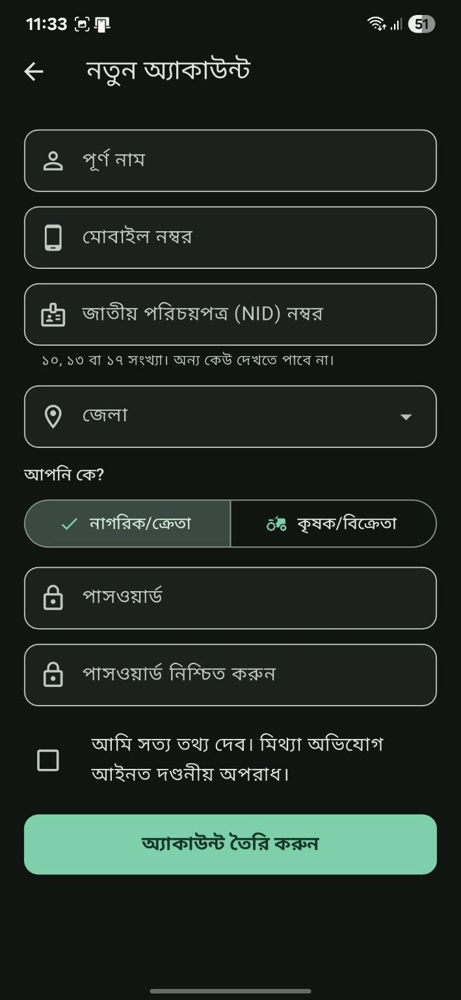
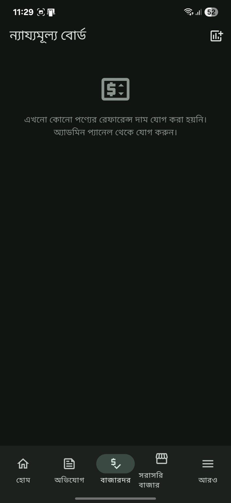
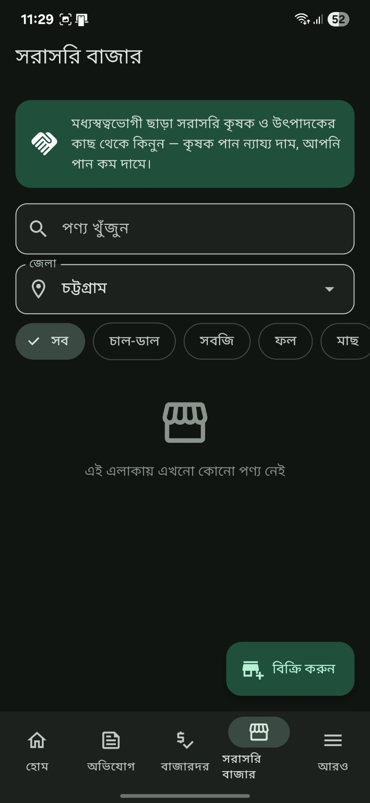

<div align="center">

# 🇧🇩 Syndicate-Free Bangladesh

### A civic-tech platform for fair markets, citizen reporting, and public accountability

A bilingual (Bangla / English) Flutter application designed to help citizens, farmers, producers, and authorities identify, report, and address syndicate-related problems across **13 sectors in Bangladesh**.

<br>



<br>

**Flutter · Dart · Firebase Authentication · Cloud Firestore · Bangla / English**

</div>

---

## 📱 Screenshots

### Home & Citizen Experience

<table>
  <tr>
    <td align="center">
      <br>
      <b>Home Dashboard</b>
    </td>
    <td align="center">
      <br>
      <b>Citizen Reports</b>
    </td>
    <td align="center">
      <br>
      <b>Report Submission</b>
    </td>
  </tr>
  <tr>
    <td align="center">
      <br>
      <b>Complaint Tracking</b>
    </td>
    <td align="center">
      <br>
      <b>Login</b>
    </td>
    <td align="center">
      <br>
      <b>Registration</b>
    </td>
  </tr>
</table>

### Market Transparency

<table>
  <tr>
    <td align="center">
      <br>
      <b>Fair-Price Board</b>
    </td>
    <td align="center">
      <br>
      <b>Direct Market</b>
    </td>
  </tr>
</table>

> **Demo data note:** The supplied Fair-Price Board screenshot currently shows the empty state because reference prices have not yet been added. The Direct Market screenshot shows the empty state for the selected district because no products are listed there yet.

---

## 🎯 Problem & Purpose

Citizens may encounter unfair pricing, excessive transport fares, market manipulation, extortion, and barriers to essential services. These issues can be difficult to document, track, and bring to the attention of the appropriate authority.

Syndicate-Free Bangladesh explores how a single digital platform can support:

- Structured citizen reporting and case tracking.
- Market-price observation and reference-price comparison.
- Better visibility into farm-gate versus retail price differences.
- Direct connections between farmers, producers, and buyers.
- Easier access to sector-specific guidance, rights information, and hotline numbers.

The app is an independent project/prototype. It is **not an official government service or authority platform**, and user-submitted allegations should not be treated as verified facts without proper review.

---

## ✨ Features

### Citizen Reporting
- Submit a report by sector, issue type, district, and location.
- Add an incident description and optional amount of money involved.
- Attach optional photo evidence.
- Choose to keep the reporter's identity private.
- Receive a unique tracking code, for example: `SBD-26-4F7K2Q`.

### Case Tracking & Workflow
- Track a submitted report through its status.
- Documented workflow: `Submitted → Under review → Verified → Forwarded to authority → Action taken`.
- Rejected cases can also be represented.
- Display status history and authority notes where available.

### Credibility Scoring
- Uses signals such as citizen corroboration, photo evidence, and official verification to help prioritize reports.
- The score is intended as a review-prioritization aid, not proof that an allegation is true.

### Fair-Price Board
- Collect citizen-reported market prices by district.
- Compare a seven-day median with an administrator-configured reference price.
- Flag prices that appear above the reference level or are increasing sharply.

### Middleman Meter
- Shows the difference between farm-gate and retail prices for selected products.
- Helps users understand price gaps across the supply chain.

### Direct Market
- Allows farmers and producers to list products for buyers.
- Supports product search, district selection, and category filters.
- Helps buyers contact producers directly.
- Displays a fair-price indicator when a listing meets the configured reference price.

### BRTA Fare Calculator
- Calculates configured fares for city buses, minibuses, and long routes.
- Uses administrator-editable fare rates.
- Helps users identify possible overcharging and prepare a report.

### Medicine MRP Checker
- Helps compare the price paid for a medicine with its printed Maximum Retail Price (MRP).
- Provides a way to report a price discrepancy.

### Authority Dashboard
- Key performance indicators and report summaries.
- Reports grouped by sector and status.
- District and location hotspot views.
- Case queue with credibility-based prioritization.
- Reference-price and fare configuration.
- Demo-data loading for presentations.

### Rights Information & Hotlines
Includes commonly used service numbers and rights information, such as:

| Hotline | Service |
|---|---|
| 999 | Emergency service |
| 333 | Government information and services |
| 106 | Anti-Corruption Commission |
| 16121 | Consumer rights |
| 16263 | Health service |
| 16122 | Land service |
| 16123 | Agriculture |
| 109 | Women and children support |

Users should confirm hotline availability and the appropriate service before relying on a number.

### 13 Sectors Covered

1. Transport and buses
2. Food and essential commodities
3. Government hospitals
4. Medicine and pharmacies
5. Agriculture
6. Rail, launch, and air tickets
7. Government service offices
8. Land and registry
9. Education
10. Overseas employment
11. Electricity, gas, and LPG
12. Construction materials
13. Markets, ghats, and footpath extortion

---

## 🧰 Tech Stack

- **Framework:** Flutter
- **Language:** Dart
- **Authentication:** Firebase Authentication
- **Cloud database:** Cloud Firestore
- **Database access control:** Firestore Security Rules
- **Platform:** Android
- **Localization:** Bangla / English

---

## 🚀 Getting Started

### Prerequisites

- Flutter 3.27 or newer
- Android Studio and Android SDK
- A Firebase project

### 1. Clone the repository

```bash
git clone https://github.com/TanimBD/syndicateless_bd.git
cd syndicateless_bd
```

### 2. Configure Firebase

In the Firebase Console:

1. Create or select a Firebase project.
2. Register an Android app with package name:

   `com.tanimbd.syndicatelessbd`

3. Download `google-services.json` and place it at:

   `android/app/google-services.json`

4. Under **Authentication → Sign-in method**, enable **Anonymous** sign-in if required by the app's current database-access implementation.
5. Create a Cloud Firestore database.
6. Review and publish the repository's `firestore.rules`.

### 3. Install dependencies

```bash
flutter pub get
```

### 4. Run the app

```bash
flutter run
```

---

## 🛡️ Administrator Setup

The current project setup uses a device-ID-based administrator allowlist:

1. Open the app and navigate to **More → Device ID**.
2. Copy the device ID displayed by the app.
3. In Cloud Firestore, create a document at:

   `admins/<device-id>`

4. Add a field such as:

   `name: "Admin"`

5. Restart the app.
6. The **More → Authority dashboard** entry should then be available to the authorized device.

In **Authority Dashboard → Settings**, use **Load default reference data** to populate initial reference values. Keep reference prices and fare rates updated from reliable sources.

---

## 🔐 Security & Privacy

The project documentation describes these safeguards:

- Passwords are salted and hashed before storage.
- NID numbers are not displayed publicly.
- Firestore rules are intended to prevent citizens from changing roles, editing other users' data, or changing case statuses.
- Reports can be submitted with the reporter's identity kept private.

### Production hardening considerations

Before a public production launch, further review is recommended:

- Move sensitive authentication and verification logic to trusted server-side code, such as Cloud Functions.
- Consider Firebase Phone Authentication / OTP for phone-number verification.
- Use an authorized identity-verification process if NID verification is required.
- Test Firestore rules and enforce least-privilege access.
- Add abuse prevention, rate limiting, moderation, audit logs, and secure evidence-file access.
- Establish clear consent, privacy, data-retention, and complaint-handling policies.

Never commit service-account private keys, signing keys, passwords, or other secrets. Do not publish phone numbers, NID details, device IDs, or private complaint evidence in screenshots or public documentation.

---

## 📦 Release Build

Build an Android App Bundle with:

```bash
flutter build appbundle --release
```

Configure Android signing securely before creating a production release. Keep the upload keystore and `key.properties` out of version control.

---

## 🔭 Planned Improvements

- Add clearly labeled sample products and reference prices for demonstrations.
- Capture populated Fair-Price Board and Direct Market screenshots.
- Add an Authority Dashboard screenshot and short walkthrough video.
- Expand automated tests for reporting, case transitions, and Firestore access rules.
- Improve moderation, anti-spam, and production security safeguards.
- Validate hotline and reference-price information with authoritative sources.

---

## 👨‍💻 Developer

**MD Tanim Hossen**  
GitHub: [@TanimBD](https://github.com/TanimBD)

**Repository:** [github.com/TanimBD/syndicateless_bd](https://github.com/TanimBD/syndicateless_bd)

---

<div align="center">

**Syndicate-Free Bangladesh** · Built in Bangladesh 🇧🇩

</div>
